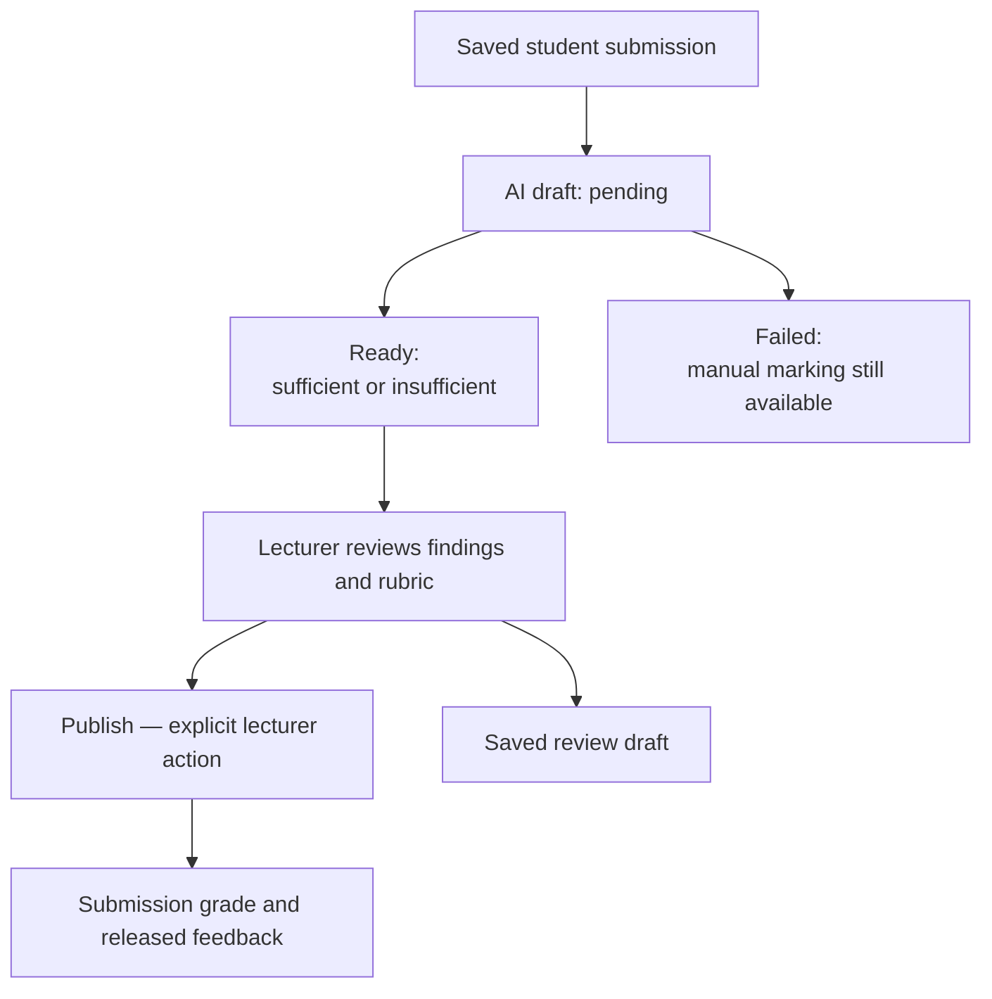

# Human review

Every AI evaluation in LARAS is a **draft** until a lecturer publishes it. This separation is the platform's most important safety property.

## The life of an evaluation

These are separate storage and authorization boundaries — **not** an automatic release pipeline. Generation never silently publishes grades.

## What the lecturer sees and does

The evaluation workspace shows the AI draft next to the student's actual work. The lecturer can:

- **Confirm or reject each finding** — including findings the AI missed can be added manually
- **Adjust rubric scores** criterion by criterion
- **Annotate** findings with their own notes
- **Save a review draft** and come back later
- **Publish** — the single explicit action that releases results to the student

Review decisions are stored **separately from the model output**. The published feedback a student sees comes from the published record, never from the raw AI draft.

## Why decisions are stored separately

Keeping model output and lecturer decisions in separate records means the platform can later answer honest questions: *How often did lecturers agree with the AI? Which finding types get corrected? Did a prompt change help?* This is exactly what the [quality measurement](/docs/how-it-works/ai-feedback/scoring) compares against — but it only works because the raw draft was never overwritten by review.

## Regeneration

Lecturers can regenerate an AI draft — for example after changing the task configuration or approving new material. Regeneration uses **current** task and material settings, and creates new draft state; it does not modify published grades, which remain a separate, lecturer-owned operation.

## Research evaluations

For controlled research studies (independent rater rounds), the platform supports **blinded review**: raters see only their own round's judgments, never another rater's identity or notes, and adjudication only becomes possible after both independent raters have submitted. This machinery exists for research and does not change the normal lecturer workflow. Details are in the engineering handbook's [research rater integration](/docs/engineering/p1-research-rater) note.
