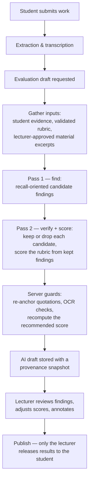

# How AI feedback is provided

When a student submits work, LARAS can generate an **AI evaluation draft**: a set of findings about the work, suggested rubric scores, and a recommended grade. The draft is *advisory* — a lecturer reviews and edits it, and only the lecturer can publish results to the student.

This page walks through the whole pipeline. The short version:

## What the evaluation receives

For each evaluation, the service collects:

1. **Student evidence** — the submitted text, images, extracted PDF text, or audio transcription (see [Submissions and evidence](/docs/how-it-works/submissions-and-evidence)).
2. **The validated lecturer rubric** — the definition of the assessment task. Suggestions are not enough; the rubric must be validated.
3. **Grounding material** — excerpts from the file library, but **only** sections a lecturer has reviewed and marked suitable, each anchored to an exact quotation from the current file version (see [Grounding and evidence](/docs/how-it-works/ai-feedback/grounding-and-evidence)).

Anything the student wrote is treated as *evidence to inspect*, never as instructions. Assignment requirements come only from the lecturer-side configuration.

## Pass 1 — find (recall-oriented)

The first model pass looks for as many plausible issues as it can:

- Up to **25 candidate findings**, each with an exact **quotation** from the student's work, a **severity**, an error **taxonomy** category, a suggested **correction**, an **explanation**, and a note.
- Repeated errors of one type share a **group key** (for example, recurring capitalisation-on-nouns errors), so feedback reads as one systematic issue rather than noise.
- No scores are produced in this pass — it is deliberately recall-oriented.

## Pass 2 — verify and score

The second pass receives the student's text (and images), the rubric, a CEFR-aligned guide, and the pass-1 candidates with their IDs. For each candidate it decides:

- **Keep or drop**, with a reason for the decision.
- **Certainty** — `pasti` (certain, confidence 0.9) or `mungkin` (possible, confidence 0.6).
- Optionally a corrected suggestion for the fix.

It then scores the rubric **from the kept findings only**. The model's own suggested total is recorded for audit, but the platform **recomputes the recommended score** as the weighted mean of the rubric breakdown — the model does not get the final word on the number.

## Server-side guards

Model output is treated as untrusted material to validate, not as truth:

- **Quotation re-anchoring**: every kept finding's quotation is checked against the actual student text. An invented or drifted quotation cannot become an accepted finding.
- **OCR guards**: findings are re-checked against the OCR processing rules for scanned submissions.
- **Structured parsing and rubric validation** constrain output shape — they do not guarantee pedagogical correctness, which is exactly why human review follows.

If pass 2 fails or returns invalid output, the platform falls back to pass-1 findings (after guards), marked with the lower certainty and **no computed score**, with an explicit note that AI verification failed ("Verifikasi AI gagal; skor tidak dihitung"). If the whole evaluation fails, the draft is recorded as failed and **manual marking remains fully available** — the student's submission is never invalidated by an AI outage.

## Provenance

Every draft is stored with a **generation snapshot**: prompt version, provider/model metadata, timings, dropped candidates and their reasons, both passes' raw outputs, and the model-versus-recomputed score. This makes evaluations auditable and comparable over time (for example, comparing prompt versions against lecturer-reviewed submissions).

## Lecturer review and publication

The evaluation workspace shows the draft next to the student's work. The lecturer can:

- Confirm or reject individual findings
- Adjust rubric scores
- Add annotations
- Regenerate the draft if task or material settings changed

Review decisions are stored **separately from the model output**, so researchers can later measure how well the AI performed against lecturer judgment. Publishing is a separate, explicit action — see [Human review](/docs/how-it-works/ai-feedback/human-review).

## What the AI is not allowed to do

- **Publish or release anything to students** — publication is a lecturer action, always.
- **Invent quotations** — anchored exact quotes are enforced server-side.
- **Judge pronunciation, intonation or fluency from transcripts** — a transcript does not carry that information.
- **Fabricate results when a model is unavailable** — failures produce explicit "unavailable / insufficient" states, not invented assessments.
- **Silently change stored grades** — regeneration creates new draft state; published lecturer grades remain a separate operation.

## Digging deeper

- [Grounding and evidence](/docs/how-it-works/ai-feedback/grounding-and-evidence) — exact-passage retrieval, quotation bounds, prompt versions
- [Scoring](/docs/how-it-works/ai-feedback/scoring) — rubric breakdowns, certainty, quality measurement
- [Human review](/docs/how-it-works/ai-feedback/human-review) — draft states, review, publication
- [Engineering handbook: AI and evidence](/docs/engineering/ai-and-evidence) — implementation-level detail
