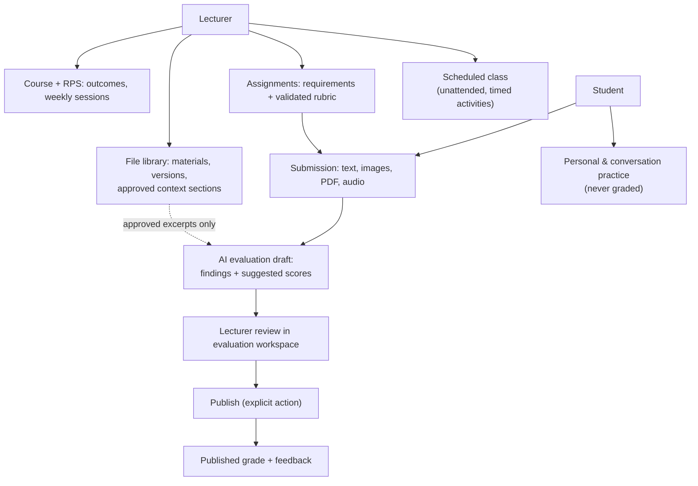

# The platform at a glance

LARAS is used by two main roles: **lecturers**, who plan courses, create assignments, and grade student work; and **students**, who attend sessions, submit assignments, and practise.

## The platform in one picture

## Courses and planning

A **course** (*mata kuliah*) is the central container. Each course carries a semester learning plan (**RPS**) that defines:

- **Program and course outcomes** — CPL (program learning outcomes), CPMK (course learning outcomes), and Sub-CPMK (more specific outcomes used for individual sessions and tasks).
- **Weekly sessions** (*pertemuan*), which lecturers build with a visual session builder: sections, materials, and learning activities.
- **Assessment structure** — how grades are composed across the semester.

Lecturers maintain a **file library** (*berkas*) of teaching materials. Uploaded files are parsed into text, versioned, and organized into sections that can be mapped to course outcomes and sessions. This library matters for AI feedback: only material a lecturer has reviewed and approved can be used as grounding for AI evaluation (see [Grounding and evidence](/docs/how-it-works/ai-feedback/grounding-and-evidence)).

## Assignments and submissions

Lecturers create **assignments** (*tugas*) with requirements, an activity shape, structured task configuration, and a **rubric**. Rubric suggestions can be drafted with AI help, but the lecturer validates the final rubric — it is the definition of the assessment task.

Students submit their work through an enrolled workspace page. A submission (*kiriman*) can contain:

- **Typed or pasted text**
- **Images** of handwritten work
- **PDF files** — including scanned pages, which are rendered to images and read with OCR
- **Audio recordings** — transcribed to text by a speech-to-text service

Submissions can also be reached through a **shared task link**, which gates into the student's normal enrolled workspace rather than creating an anonymous channel.

## Assessment: AI draft, human decision

When work is submitted, the platform can generate an **AI evaluation draft**: findings (with quotations from the student's work), a suggested rubric breakdown, and a recommended score. This is a *draft* — stored separately from grades, and visible only to the lecturer.

The lecturer reviews the draft in the **evaluation workspace**: they confirm or reject findings, adjust rubric scores, add annotations, and then **publish**. Only published results reach the student. See [How AI feedback is provided](/docs/how-it-works/ai-feedback) for the full pipeline.

## Practice (not graded)

Alongside official assignments, students have **personal practice** (*latihan*) and **conversation practice** (*percakapan*) with AI replies, speech synthesis, and transcription. These give feedback and reflection but are **never** counted as official assignment grades.

## Scheduled classes

A course session can be scheduled for **unattended operation** (*kelas terjadwal*): activities run on a timer while students participate asynchronously, and attendance and attempts are recorded for the lecturer to review afterwards.

## Assistant

Both roles have an **AI assistant** (*asisten*) that can answer questions about course material, help draft lesson plans, and perform lecturer-approved actions. Assistant actions are logged and audited; a natural-language request never grants authority by itself.

## Terminology

| Indonesian term | Meaning |
|---|---|
| Mata kuliah | Course |
| RPS | Semester learning plan |
| CPL / CPMK / Sub-CPMK | Program / course / sub-course learning outcomes |
| Pertemuan | Class session (weekly meeting) |
| Tugas | Assignment |
| Kiriman | Student submission |
| Penilaian | Assessment / marking |
| Nilai | Grade |
| Berkas | File and teaching-material library |
| Latihan | Personal practice |
| Percakapan | Conversation practice |
| Asisten | AI assistant |
| Riset | Research review and analysis tools |
