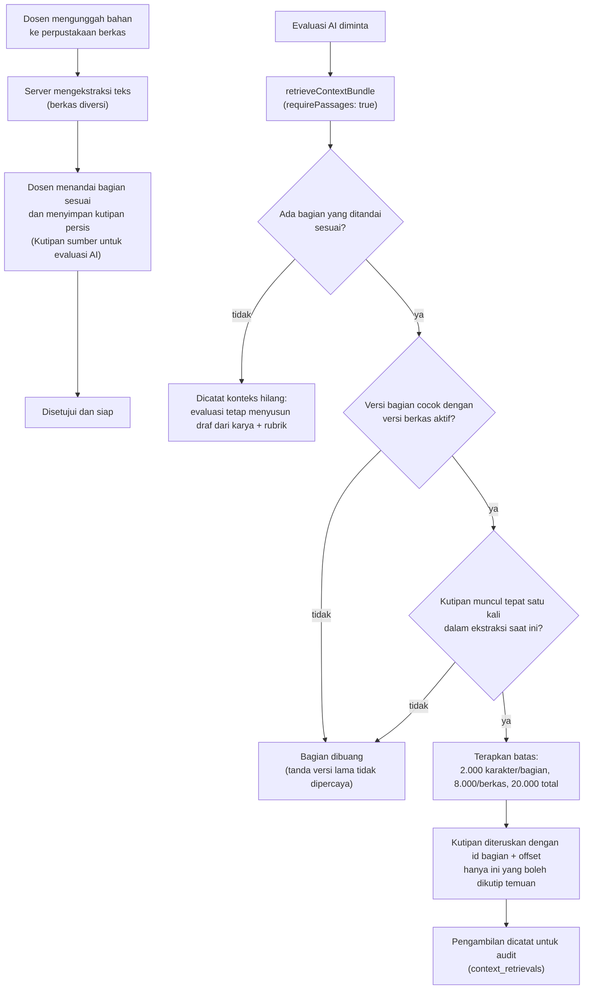

# Bukti dan pengaitan (grounding)

Umpan balik AI di LARAS dirancang untuk **berpijak pada bukti**: dikaitkan pada karya asli mahasiswa dan, bila bahan ajar relevan, pada kutipan yang secara eksplisit disetujui dosen. Halaman ini menjelaskan mekanismenya.

## Mengapa pengaitan penting

Model AI dapat menghasilkan umpan balik yang terdengar masuk akal tetapi salah. LARAS menguranginya secara struktural, bukan dengan memercayai model:

- Temuan harus **mengutip karya mahasiswa** — kutipannya diperiksa ulang di sisi server pada setiap evaluasi ("quote anchoring"), sehingga kutipan buatan tidak dapat menjadi temuan yang diterima.
- Materi konteks harus berasal dari **bagian yang telah ditinjau dosen**. Sekadar label draf bukanlah gerbang persetujuan; status bagian diperiksa pada saat pengambilan.
- Semua yang dipakai terekam dalam **rekam jejak evaluasi**, sehingga setiap hasil dapat dilacak ke masukannya.

## Rantai persetujuan dari awal sampai akhir

## Pengambilan kutipan persis

Untuk evaluasi formal, pengambilan materi mensyaratkan **kutipan persis** (`requirePassages: true`). Alurnya:

1. Dosen menyimpan kutipan persis pada kolom **"Kutipan sumber untuk evaluasi AI"** di bagian berkas konteks yang sesuai.
2. Saat evaluasi, pengambilan memeriksa bahwa bagian dan ekstraksinya **cocok dengan versi berkas yang aktif**, dan kutipannya **muncul tepat satu kali** dalam teks hasil ekstraksi.
3. Kutipan tersebut diteruskan ke model beserta identitas bagiannya — bukan teks pembuka berkasnya.

Pencocokan kutipan **diperiksa ulang pada setiap pengambilan**, termasuk setelah berkas diganti atau diekstraksi ulang, sehingga pengaitan tidak pernah diam-diam merujuk konten usang.

## Batas konteks

Materi yang diteruskan dibatasi sengaja agar prompt tetap fokus:

| Batas | Nilai |
|---|---|
| Per bagian | 2.000 karakter |
| Per berkas | 8.000 karakter |
| Keseluruhan | 20.000 karakter |
| Berkas | maksimal 4 |
| Bagian per berkas | maksimal 6 |

Pemotongan **diberi label** — evaluasi tahu apa yang diberikan dan yang tidak — dan hanya bagian yang benar-benar disertakan yang dapat menerima kutipan bahan pada temuan.

Bila tidak ada kutipan terverifikasi, evaluasi formal mencatat **konteks hilang** dan tetap dapat menyusun draf dari karya mahasiswa, tugas, dan rubrik. Ia tidak diam-diam beralih ke materi yang belum ditinjau.

## Versi prompt

Alur evaluasi diverisi (per versi) agar hasil dapat dibandingkan:

| Versi | Nama | Ide utama |
|---|---|---|
| v3 | `german-gfl-feedback-v3-passages` | Memisahkan saran gaya dari temuan kesalahan; meminta koreksi yang memelihara makna dan kutipan berbasis bukti; melarang menilai pelafalan dari transkrip |
| v4 | `german-gfl-feedback-v4-ocr` | Evaluasi satu tahap yang sadar OCR |
| v5 | `german-gfl-feedback-v5-two-pass` | Bawaan saat ini: alur dua tahap temukan → verifikasi + skor seperti di [Bagaimana umpan balik AI diberikan](/docs/id/how-it-works/ai-feedback) |

Versi prompt terekam dalam rekam jejak setiap draf. Mengubah prompt tidak mengubah draf lama secara surut.

## Konteks pembelajaran vs. bahan yang disetujui

Prompt evaluasi membawa dua masukan konteks yang berbeda, dan perannya sengaja dipisahkan:

| | Konteks pembelajaran | Bahan yang disetujui dosen |
|---|---|---|
| Berasal dari | Pertemuan terkait (topik, indikator capaian, materi ajar) beserta capaian Sub-CPMK/CPMK | Bagian perpustakaan berkas yang ditandai sesuai, masing-masing dikaitkan kutipan persis |
| Label dalam prompt | `KONTEKS PEMBELAJARAN` | `MATERI KONTEKS YANG DISETUJUI DOSEN` |
| Peran | Menilai *kesesuaian isi* — apakah jawaban sesuai apa yang diajarkan, dalam kosakata dan struktur yang diharapkan | *Bukti* yang dapat dikutip untuk penilaian isi |
| Batasan | Tidak pernah dipakai sebagai aturan bahasa | Temuan hanya boleh mengutip bahan dengan menunjuk kutipan terverifikasi yang benar-benar mendukung penjelasan; label bagian atau nomor halaman saja bukan bukti |

Tidak ada satu pun yang memberi skor: tahap 2 menilai rubrik **hanya** dari teks mahasiswa dan temuan yang dipertahankannya. Bila tidak ada bahan disetujui yang memenuhi syarat, prompt menyatakan secara eksplisit bahwa model tidak boleh mengarangnya, dan evaluasi tetap menyusun draf dari karya mahasiswa, tugas, dan rubrik.

## Apa yang tidak diklaim oleh pengaitan

Pengaitan membuat umpan balik *terlacak*, bukan otomatis *benar*. Parsing terstruktur dan validasi membatasi bentuk keluaran; keduanya tidak menjamin kebenaran pedagogis. Karena itulah peninjauan dosen tetap menjadi gerbang akhir — lihat [Peninjauan manusia](/docs/id/how-it-works/ai-feedback/human-review).
