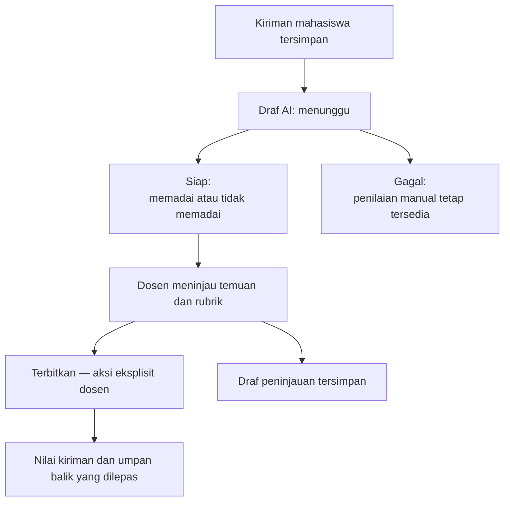

# Peninjauan manusia

Setiap evaluasi AI di LARAS adalah **draf** sampai dosen menerbitkannya. Pemisahan ini adalah properti keamanan terpenting platform.

## Riwayat hidup sebuah evaluasi

Ini adalah batasan penyimpanan dan otorisasi yang terpisah — **bukan** alur pelepasan otomatis. Generasi tidak pernah diam-diam menerbitkan nilai.

## Apa yang dilihat dan dilakukan dosen

Ruang kerja evaluasi menampilkan draf AI di samping karya asli mahasiswa. Dosen dapat:

- **Mengonfirmasi atau menolak setiap temuan** — temuan yang terlewat AI dapat ditambahkan secara manual
- **Menyesuaikan skor rubrik** kriteria demi kriteria
- **Menganotasi** temuan dengan catatannya sendiri
- **Menyimpan draf peninjauan** dan kembali lagi nanti
- **Menerbitkan** — satu aksi eksplisit yang melepas hasil kepada mahasiswa

Keputusan peninjauan disimpan **terpisah dari keluaran model**. Umpan balik yang diterbitkan dan dilihat mahasiswa berasal dari catatan yang diterbitkan, bukan dari draf AI mentah.

## Mengapa keputusan disimpan terpisah

Menyimpan keluaran model dan keputusan dosen dalam catatan terpisah membuat platform dapat menjawab pertanyaan jujur: *Seberapa sering dosen setuju dengan AI? Jenis temuan apa yang sering dikoreksi? Apakah perubahan prompt membantu?* Persisnya itulah yang dibandingkan oleh [pengukuran kualitas](/docs/id/how-it-works/ai-feedback/scoring) — dan itu hanya berfungsi karena draf mentah tidak pernah ditimpa oleh peninjauan.

## Regenerasi

Dosen dapat meregenerasi draf AI — misalnya setelah mengubah konfigurasi tugas atau menyetujui bahan baru. Regenerasi memakai pengaturan tugas dan bahan **terkini**, dan menciptakan keadaan draf baru; ia tidak mengubah nilai yang sudah diterbitkan, yang tetap menjadi operasi terpisah milik dosen.

## Evaluasi riset

Untuk studi riset terkontrol (ronde penilai independen), platform mendukung **peninjauan buta**: penilai hanya melihat penilaian ronde mereka sendiri, tidak pernah identitas atau catatan penilai lain, dan adjudikasi hanya mungkin setelah kedua penilai independen mengumpulkan. Mekanisme ini ada untuk riset dan tidak mengubah alur kerja dosen normal. Detailnya ada di catatan [integrasi penilai riset](/docs/id/engineering/p1-research-rater) pada buku pegangan teknis.
