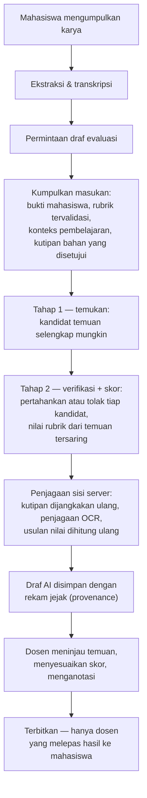
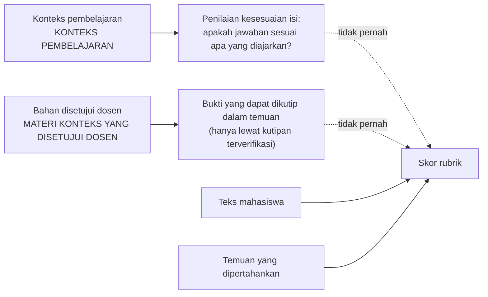

# Bagaimana umpan balik AI diberikan

Saat mahasiswa mengumpulkan karya, LARAS dapat menghasilkan **draf evaluasi AI**: sekumpulan temuan atas karya tersebut, usulan skor rubrik, dan usulan nilai. Draf ini bersifat *saran* — dosen meninjaunya, mengeditnya, dan hanya dosen yang dapat menerbitkan hasil kepada mahasiswa.

Halaman ini menelusuri seluruh alurnya. Versi singkatnya:

## Apa yang diterima evaluasi

Untuk setiap evaluasi, layanannya mengumpulkan:

1. **Bukti mahasiswa** — teks kiriman, gambar, teks hasil ekstraksi PDF, atau transkripsi audio (lihat [Kiriman dan bukti](/docs/id/how-it-works/submissions-and-evidence)).
2. **Rubrik dosen yang tervalidasi** — definisi soal penilaian. Sekadar usulan tidak cukup; rubrik harus tervalidasi.
3. **Bahan dasar (grounding)** — kutipan dari perpustakaan berkas, tetapi **hanya** bagian yang telah dosen tinjau dan tandai sesuai, masing-masing dikaitkan pada kutipan persis dari versi berkas yang aktif (lihat [Bukti dan pengaitan](/docs/id/how-it-works/ai-feedback/grounding-and-evidence)).
4. **Konteks pembelajaran** — pertemuan yang terkait dengan tugas (minggu, topik, indikator capaian, materi yang diajarkan) beserta Sub-CPMK/CPMK-nya: apa yang benar-benar diajarkan.

Kedua masukan konteks memiliki tugas yang terpisah tegas — dan satu hal yang tidak pernah mereka lakukan:

- **Konteks pembelajaran** memandu penilaian *kesesuaian isi*: apakah jawaban sesuai apa yang diajarkan, dengan kosakata dan struktur yang diharapkan. Ia tidak pernah menjadi sumber aturan bahasa.
- **Bahan yang disetujui dosen** menyediakan *bukti yang dapat dikutip*: temuan hanya boleh merujuknya lewat kutipan terverifikasi yang benar-benar mendukung penjelasan.
- **Tidak ada yang pernah memberi skor.** Penilaian dihitung hanya dari teks mahasiswa dan temuan yang dipertahankan.

Apa pun yang ditulis mahasiswa diperlakukan sebagai *bukti untuk diperiksa*, bukan sebagai instruksi. Persyaratan tugas hanya berasal dari konfigurasi di sisi dosen.

## Di mana konteks masuk — dan apa yang boleh dilakukannya

## Tahap 1 — temukan (mengutamakan cakupan)

Tahap model pertama mencari sebanyak mungkin isu yang layak:

- Hingga **25 kandidat temuan**, masing-masing dengan **kutipan** persis dari karya mahasiswa, **tingkat keparahan**, kategori **taksonomi** kesalahan, usulan **perbaikan**, **penjelasan**, dan catatan.
- Kesalahan berulang dengan satu jenis berbagi **kunci grup** (misalnya kesalahan kapitalisasi pada kata benda yang berulang), sehingga umpan balik terbaca sebagai satu isu sistematis, bukan derau.
- Tahap ini tidak menghasilkan skor apa pun — sengaja dibuat untuk cakupan semaksimal mungkin.

## Tahap 2 — verifikasi dan beri skor

Tahap kedua menerima teks mahasiswa (beserta gambar), rubrik, panduan selaras CEFR, dan kandidat tahap 1 beserta ID-nya. Untuk setiap kandidat ia memutuskan:

- **Pertahankan atau tolak**, beserta alasan keputusannya.
- **Keyakinan** — `pasti` (confidence 0.9) atau `mungkin` (confidence 0.6).
- Seandainya perlu, usulan perbaikan yang dikoreksi.

Tahap ini kemudian menilai rubrik **hanya dari temuan yang dipertahankan**. Usulan total milik model sendiri hanya direkam untuk audit — platform **menghitung ulang usulan nilai** sebagai rata-rata tertimbang dari rincian rubrik. Model tidak mendapat kata final atas angkanya.

## Penjagaan di sisi server

Keluaran model diperlakukan sebagai materi tak terpercaya yang harus divalidasi, bukan sebagai kebenaran:

- **Penjangkatan ulang kutipan**: kutipan setiap temuan yang dipertahankan diperiksa terhadap teks asli mahasiswa. Kutipan yang direkayasa tidak dapat menjadi temuan yang diterima.
- **Penjagaan OCR**: temuan diperiksa ulang terhadap aturan pemrosesan OCR untuk kiriman hasil pindai.
- **Parsing terstruktur dan validasi rubrik** membatasi bentuk keluaran — namun tidak menjamin kebenaran pedagogis, dan justru karena itulah peninjauan manusia mengikuti.

Bila tahap 2 gagal atau menghasilkan keluaran tidak sah, platform beralih ke temuan tahap 1 (setelah penjagaan), ditandai keyakinan lebih rendah dan **tanpa skor**, dengan catatan tegas bahwa verifikasi AI gagal ("Verifikasi AI gagal; skor tidak dihitung"). Bila keseluruhan evaluasi gagal, draf dicatat sebagai gagal dan **penilaian manual tetap sepenuhnya tersedia** — kiriman mahasiswa tidak pernah hangus karena gangguan AI.

## Rekam jejak (provenance)

Setiap draf disimpan bersama **rekam jejak generasi (generation snapshot)**: versi prompt, metadata penyedia/model, waktu proses, kandidat yang ditolak beserta alasannya, keluaran mentah kedua tahap, serta skor milik model versus skor hasil perhitungan ulang. Ini membuat evaluasi dapat diaudit dan dibandingkan seiring waktu (misalnya membandingkan versi prompt terhadap kiriman yang sudah ditinjau dosen).

## Peninjauan dan penerbitan oleh dosen

Ruang kerja evaluasi menampilkan draf di samping karya mahasiswa. Dosen dapat:

- Mengonfirmasi atau menolak temuan satu per satu
- Menyesuaikan skor rubrik
- Menambah anotasi
- Meregenerasi draf bila pengaturan tugas atau bahan berubah

Keputusan peninjauan disimpan **terpisah dari keluaran model**, sehingga nanti dapat diukur seberapa baik kinerja AI dibanding penilaian dosen. Penerbitan adalah aksi terpisah dan eksplisit — lihat [Peninjauan manusia](/docs/id/how-it-works/ai-feedback/human-review).

## Apa yang tidak boleh dilakukan AI

- **Menerbitkan atau melepas apa pun kepada mahasiswa** — penerbitan selalu aksi dosen.
- **Merekayasa kutipan** — kutipan persis yang dijangkatkan dipaksa di sisi server.
- **Menilai pelafalan, intonasi, atau kelancaran dari transkrip** — transkrip tidak memuat informasi itu.
- **Membuat-buat hasil ketika model tidak tersedia** — kegagalan menghasilkan status "tidak tersedia / tidak memadai" yang eksplisit, bukan penilaian buatan.
- **Mengubah nilai tersimpan secara diam-diam** — regenerasi membuat keadaan draf baru; nilai dosen yang sudah diterbitkan tetap operasi terpisah.

## Menyelami lebih dalam

- [Bukti dan pengaitan](/docs/id/how-it-works/ai-feedback/grounding-and-evidence) — pengambilan kutipan persis, batas konteks, versi prompt
- [Penilaian](/docs/id/how-it-works/ai-feedback/scoring) — rincian rubrik, keyakinan, pengukuran kualitas
- [Peninjauan manusia](/docs/id/how-it-works/ai-feedback/human-review) — keadaan draf, peninjauan, penerbitan
- [Buku pegangan teknis: AI dan bukti](/docs/id/engineering/ai-and-evidence) — detail tingkat implementasi
