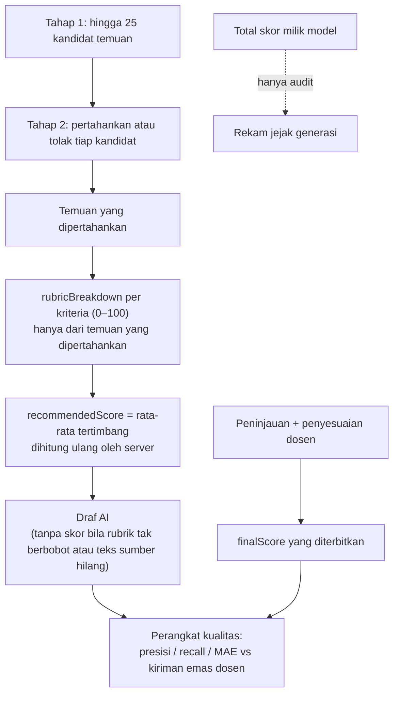

# Penilaian

Evaluasi AI menghasilkan **usulan skor** — bukan nilai final. Halaman ini menjelaskan cara usulan itu dihitung dan bagaimana kualitasnya diukur.

## Dari rubrik ke usulan nilai

1. **Rubrik tervalidasi** milik tugas menentukan kriteria dan bobotnya.
2. Pada tahap 2 evaluasi, model memberi umpan balik dan skor per kriteria — tetapi hanya dari **temuan yang dipertahankan** (lihat [Bagaimana umpan balik AI diberikan](/docs/id/how-it-works/ai-feedback)).
3. Platform **menghitung ulang** usulan nilai sebagai **rata-rata tertimbang dari rincian rubrik**.
4. Total skor milik model sendiri disimpan **hanya untuk audit** — ia tidak pernah menjadi usulan resmi.

Dengan ini angkanya konsisten dengan detail tingkat kriteria: bila rincian rubrik mengatakan 74, usulan nilainya mengatakan 74.

## Tingkat keyakinan

Setiap temuan membawa keyakinan dari tahap 2:

| Keyakinan | Confidence | Arti |
|---|---|---|
| `pasti` | 0.9 | Terverifikasi dengan keyakinan tinggi |
| `mungkin` | 0.6 | Masuk akal tetapi kurang pasti |

Temuan dari jalur cadangan (saat tahap 2 gagal) selalu ditandai `mungkin` dan **tanpa skor**. Draf yang lebih lama, sebelum ada keyakinan, tetap ditampilkan tanpa lencana.

## Kandidat yang ditolak tetap disimpan untuk audit

Saat tahap 2 menolak kandidat dari tahap 1, penolakan itu tidak dibuang: kandidat yang ditolak beserta alasannya disimpan dalam rekam jejak riset, bersama waktu proses tiap tahap dan keluaran mentah. Inilah yang memungkinkan analisis kualitas di kemudian hari.

## Mengukur kualitas terhadap dosen

Perangkat pengukur kualitas menjalankan ulang alur dalam **mode dry-run** (tidak ada yang disimpan) pada *kiriman emas* — yang telah ditinjau penuh atau diterbitkan dosen — dan membandingkan:

| Metrik | Pertanyaan yang dijawab |
|---|---|
| **Presisi** | Dari temuan AI, berapa yang cocok dengan temuan yang disetujui dosen? |
| **Recall** | Dari temuan yang disetujui dan ditambahkan dosen, berapa yang ditemukan AI? |
| **MAE skor** | Seberapa jauh usulan nilai dari nilai yang diterbitkan dosen? |

Pencocokan dilakukan lewat tumpang-tindih kutipan, per kategori rubrik, dan dapat dibandingkan antar versi prompt — misalnya menjalankan kiriman yang sama melalui alur v4 dan v5. Perangkatnya ada di repositori (`apps/web/scripts/eval-ai-quality.mjs`); lihat [buku pegangan teknis](/docs/id/engineering/ai-and-evidence) untuk detailnya.

## Batasannya

- Usulan skor adalah **saran**. Peninjauan dosen, penyesuaian skor rubrik, dan penerbitan adalah keputusan terpisah yang disimpan terpisah dari keluaran model.
- AI tidak pernah dilatih otomatis dari suntingan dosen; perbandingan kualitas berjalan terhadap kiriman yang ditinjau dosen secara terpisah (held-out), bukan siklus pembelajaran langsung.
