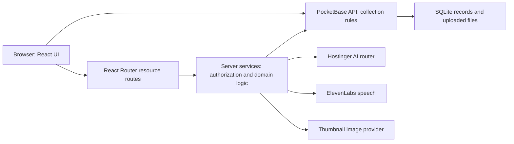
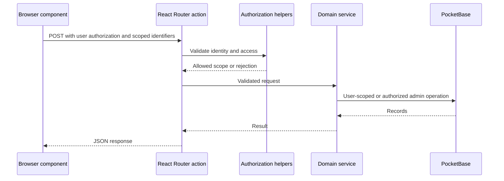

# Architecture and code ownership

LARAS is an Indonesian learning-management application with lecturer course planning, assignments and assessment, student practice, and AI assistance. The repository is an npm workspace containing a web app and a PocketBase app. There is no separate Python AI service or separate game backend in this repository.

Production Traefik sends `/hcgi/platform/api` requests directly to PocketBase after stripping `/hcgi/platform`. Other requests reach the web container. In local development the web proxy implements the same API prefix. The exact rules are in [docker-compose.yml](../../docker-compose.yml) and [the proxy](../../apps/web/src/routes/hcgi.platform.$.ts).

## Directory responsibilities

| Location | Owns | Start here |
|---|---|---|
| `apps/web/src/routes.ts` | Explicit URL registration and course-route nesting | [route configuration](../../apps/web/src/routes.ts) |
| `apps/web/src/routes/` | Pages, client loaders, actions and API boundaries | [route index](routes.md) |
| `apps/web/src/components/app/` | Course, assessment, student and assistant screens | [source atlas](source-atlas.md) |
| `apps/web/src/components/ui/` | Shared UI primitives | Keep domain logic out of these components |
| `apps/web/src/lib/` | Domain models, pure scoring/parsing helpers, persistence and AI services | `.server.ts` means server-only responsibilities |
| `apps/web/src/lib/assistant/` | Assistant runtime, tools, authorization, context, history and logging | [assistant runtime](../../apps/web/src/lib/assistant/runtime.server.ts) |
| `apps/web/src/styles/`, `src/index.css` | App styling and feature styles | [root stylesheet loading](../../apps/web/src/root.tsx) |
| `apps/web/public/` | Static assets served by the web app | Treat generated media separately from source logic |
| `apps/web/plugins/` | Horizons preview/editor and development integration | [Vite config](../../apps/web/vite.config.ts) |
| `apps/web/tests/` | Vitest domain, integrity and assistant tests | [test inventory](tests.md) |
| `apps/pocketbase/pb_migrations/` | Collection schemas, access rules and schema evolution | [migration index](data-model.md) |
| `apps/pocketbase/pb_hooks/` | PocketBase event handlers and custom backend commands | [hook index](data-model.md) |
| Root Docker/Compose/scripts | Container build, persistent storage and manual release | [operations](operations.md) |

## Rendering and navigation

React Router runs with SSR enabled. [root.tsx](../../apps/web/src/root.tsx) loads shared styles, site chrome and welcome-tour infrastructure. Protected pages use browser-side authentication; not every page is nested beneath a single authenticated layout. Read the registered route and its `clientLoader` before changing access behavior.

`@/` resolves to `apps/web/src/`. Files named `api.*.ts` are resource handlers, but the URL is determined by `routes.ts`, not by filename alone. `course.section.tsx` handles multiple section names, so changing one course section can affect several screens.

## Authentication and authorization

The browser [PocketBase client](../../apps/web/src/lib/pocketbase-client.ts) uses `/hcgi/platform` and its local authentication store. [require-auth.ts](../../apps/web/src/lib/require-auth.ts) protects client navigation. This guard improves navigation behavior; PocketBase rules and server endpoint checks provide the actual data-access boundary.

The [server client](../../apps/web/src/lib/pocketbase-client.server.ts) lazily authenticates as a superuser and disables SDK request auto-cancellation. Superuser calls bypass collection rules, so an endpoint must authenticate and validate ownership/enrollment before using it. [authenticateUser](../../apps/web/src/lib/context-retrieval.server.ts) is reused by many endpoints. Assistant-specific checks live in `lib/assistant/auth.server.ts` and `authorization.server.ts`.

[api.server.ts](../../apps/web/src/lib/api.server.ts) provides response headers, size checks and API wrapping. It is not global middleware: inspect each handler's wrapper and checks. Source comments describe constraints inherited from Horizons shared edge caching. They are design history, not proof of how the current VPS proxy caches responses. Do not put personalized content in publicly cacheable HTML or change authentication storage without reviewing deployment behavior.

## What comes from where

- React Router, React, PocketBase, Radix, Recharts and other third-party packages are declared in workspace package files; exact installed versions are in the root lockfile.
- Horizons preview/editor plugins and initial app settings are inherited platform integration. They coexist with the explicit VPS Compose setup; do not assume preview hosts in an old migration are the production domain.
- LARAS course workflows, rubric review, student practice and assistant tools live in first-party `src` modules and PocketBase migrations/hooks.
- Model-generated text is runtime output, not checked-in course truth. Approved course material, student answers, lecturer decisions and AI suggestions have different provenance; see [AI and evidence](ai-and-evidence.md).
- The topic-map demo and production analysis export discussed separately are outside this repository. They are not shipped application features or documentation fixtures.

## Reading an API request

Actual handlers may combine these steps; the source atlas identifies their imports. Browser SDK operations instead go directly to PocketBase and depend on collection rules. When changing a feature, check both paths rather than assuming all writes pass through a React Router action.
