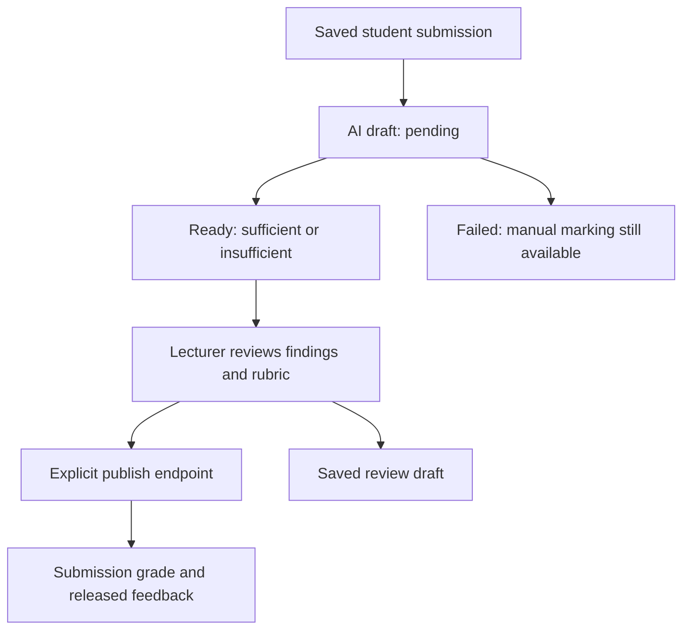

# Feature guide: from screen to storage

Each row gives the fastest route into an implementation. Use [routes](routes.md) and [source atlas](source-atlas.md) for complete imports and exact collection call sites.

| User task | Page / primary component | Service or endpoint | Main records |
|---|---|---|---|
| Public landing and login | `home.tsx`, `login.tsx`, `components/home/`, `components/auth/` | PocketBase auth; recovery-email routes | `users` |
| Lecturer dashboard | `app.tsx`, app shell | Browser PocketBase queries and dashboard helpers | courses, assignments, sessions |
| Courses and RPS | `app.courses.tsx`, `course.tsx`, `course.index.tsx`, `app.rps.$courseId.tsx`; course dashboard and RPS editor | RPS import/assist services, RPS parser/validation helpers | `courses`, `cpl`, `cpmk`, `sub_cpmk`, `topics`, `assessments`, `class_sessions` |
| Course sections | `course.section.tsx` | Course-section components and domain helpers | roster, sessions, assignments, grades, resources |
| Assignments | `app.tugas.tsx`, `app.tugas.buat.tsx`, assignment form | assignment-draft, task-config-draft, rubric-suggestions | `assignments` |
| Student submission | `app.kerja.$assignmentId.tsx`, student work page | task-submit and task-assist; browser record operations | `assignment_submissions` |
| Public-link submission | `tugas.$token.tsx` | Handler actions and public linking/drafts | `public_submissions`, linked enrolled submissions |
| Lecturer assessment | `app.tugas.$assignmentId.tsx`, evaluation workspace | evaluation draft/review/annotation/publish routes | `ai_evaluations`, `ai_feedback_items`, submission grades and feedback |
| File library and evidence | `app.berkas.tsx`, `app.berkas.$fileId.tsx`, file-context | berkas parse/process/suggest/snapshot/restore | file library, extraction, versions, contexts and sections |
| Student practice | `app.latihan.tsx`, personal-practice | personal-practice, practice-assist | personal practice settings/rounds/attempts |
| Conversation | conversation-practice component | conversation-practice route, TTS and transcription services | `student_conversation_reflections` |
| Student profile/progress | `app.student.tsx`, `course.student-profile.tsx` | student-profile, student-progress helpers | submissions, practice, learning profiles, reflections |
| Attendance/participation | Course sections, attendance manager | PocketBase rules/hooks | `attendance`, `participation_awards`, roster |
| Gradebook | `app.penilaian.tsx`, student-grades, grouped-gradebook | course-grade-summary, gradebook helpers | grade components/entries/publications/overrides |
| Course analytics | Course section analytics | course-analytics helpers | assignments, submissions, academic outcomes |
| Research | `app.riset.tsx`, research analytics/export | research routes, rater authorization, feedback uptake | feedback items, rater assignments, revision/uptake records |
| Lecturer assistant | `app.asisten.tsx`, assistant panel | assistant runtime, tools, agent tasks, lesson plans | assistant sessions/messages/audits, agent tasks, lesson plans |
| Student assistant | Student-facing assistant UI | student-assistant and tools | student assistant chats/audits, AI usage |
| Animated guidance | App shell, workspace-guide, welcome-tour | Local UI state and static tour assets | Inspect components for dismissal persistence |

## Assignment evaluation, end to end

1. The student submits to an enrolled or public submission record. The assignment defines requirements, activity shape, structured task configuration and rubric.
2. `api.evaluation-draft.ts` verifies caller access and queues work through `ai-evaluation.server.ts`. An AI failure does not invalidate the saved submission.
3. Evaluation collects student text/evidence, validated rubric and available scoped materials. Its parser validates findings and quotation anchors. See `ai-evaluation.ts`, `evaluation-rubric.ts`, `evaluation-scoring.ts` and `evaluation-snapshot.server.ts`.
4. The evaluation workspace displays AI suggestions and lecturer editing controls. `evaluation-review.server.ts` and annotation services preserve review decisions separately from model output.
5. `api.evaluation-publish.ts` publishes lecturer-approved results. Student-result and published-feedback components display released results, not private AI drafts.

For incorrect highlights inspect `answer-evidence` components and `evaluation-annotation.server.ts`; for a broken original PDF preview search `SubmissionPdfPreview` in the component tree. Compare the original file with extracted text before deciding the student's language is wrong.

## Material preparation, end to end

A library upload has metadata and a version. Extraction produces text plus parser/status information. Suggested context mappings are reviewed; suitable sections map content to academic outcomes and sessions. Retrieval selects scope- and version-matched evidence and records a bundle/citations. File restoration and snapshot services preserve version history. `context-retrieval.server.ts` is the central selection boundary; see its feature contracts rather than duplicating retrieval in a new endpoint.

## Practice versus official assessment

Personal practice and conversation provide feedback and reflection. They are not official assignment grades. Structured reading/listening/speaking/writing configuration types existing in code do not establish that a particular course currently uses all those activities. Legacy `formative_*` collections/helpers and old phase terminology remain in source history; do not interpret those names alone as an active product feature.

Conversation uses recorded audio segments, transcription, model replies and speech synthesis. It is a turn-based HTTP pipeline with voice-activity handling, not a continuous provider realtime socket. `conversation-turns.ts` controls the six-turn closing behavior; `conversation-vad.ts` handles client voice activity. Reflections are saved through the conversation route and displayed through student-profile integration.

## Assistant actions

Read `lib/assistant/runtime.server.ts` for the loop and `tools.server.ts` for available operations. Context, history compaction, persistence and audit are separate modules. A natural-language request is not blanket authority: tool authorization and confirmation handling matter. Agent tasks and lesson plans have their own state, revisions and PocketBase hooks. See the existing [agent workflow guide](../agent-workflows.md).

## Terminology for engineers

| UI term | Meaning in code |
|---|---|
| Mata kuliah | Course |
| RPS | Semester learning plan; course identity, outcomes, weekly planning and assessment structure |
| CPL | Program learning outcome |
| CPMK | Course learning outcome |
| Sub-CPMK | More specific outcome used for sessions and tasks |
| Pertemuan | Class session / weekly meeting |
| Tugas | Assignment |
| Kiriman | Student submission |
| Penilaian | Assessment / marking |
| Nilai | Grade |
| Berkas | Files and teaching-material library |
| Latihan | Personal practice; distinguish from officially graded assignments |
| Percakapan | Conversation practice |
| Asisten | AI assistant |
| Riset | Research review/analysis tools |

## Assessment state boundaries

These are separate storage/authorization boundaries, not an automatic release pipeline. Generation must not silently publish grades. A pending task started inside the web process is not the same as a durable external job queue; inspect the queue implementation when improving restart/retry behavior.
